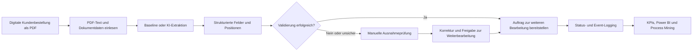
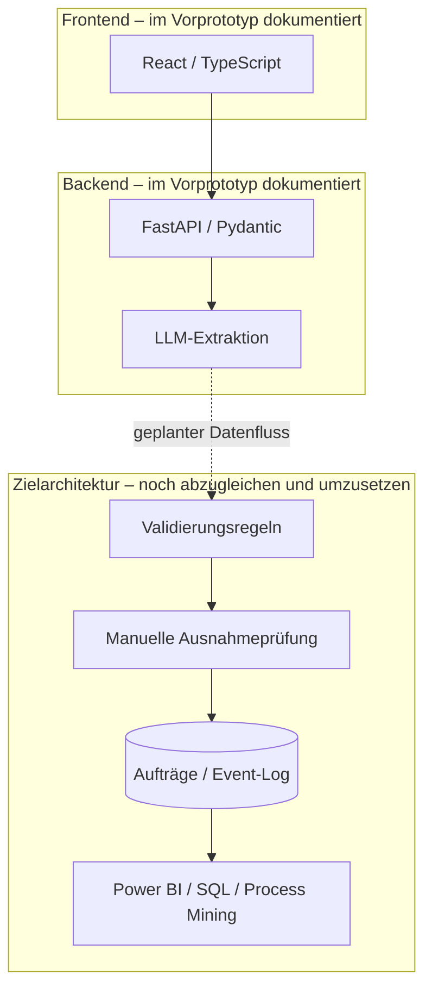
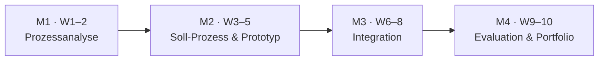

<div align="center">

# 🧠 Smart Order Processing

### Intelligent Document Processing × Business Process Optimization

**Von der Kundenbestellung zum validierten Auftrag – mit messbarer Qualität und nachvollziehbarem Prozessnutzen.**

[](#-implementierungsstand--verifikation)
[](#-implementierungsstand--verifikation)
[](#-daten-sicherheit--lizenz)

[](#-architektur--tech-stack)
[](#-architektur--tech-stack)
[](#-evaluation-technik--wirtschaftlichkeit)
[](#-daten-sicherheit--lizenz)

**Ahmet · Process Optimization & Business Analysis** 　|　 **Enes · AI & Software Engineering**

*Intelligent Process Optimization Lab · AI Engineering × Process Excellence*

</div>

---

> [!IMPORTANT]
> **Transparenter Projektstatus (19.11.2026):** Ein technischer Vorprototyp mit FastAPI, React, Claude-Anbindung und Datei-Upload ist im bisherigen README dokumentiert. Funktion, Tests und Verständnis wurden **noch nicht gemeinsam verifiziert oder abgenommen**. Deshalb gibt es hier bewusst keine unbelegten „MVP live“-Versprechen.

<table>
<tr>
<td width="50%" valign="top">

### 🏭 Das Geschäftsproblem
Unternehmen erhalten Kundenbestellungen in unterschiedlichen PDF-Layouts. Die manuelle Übertragung und Prüfung bindet Kapazitäten und kann Fehler verursachen. Wir entwickeln einen Ansatz, um diesen Prozess strukturiert zu digitalisieren und zu verbessern.

</td>
<td width="50%" valign="top">

### 🎓 Unser Projektziel
**Einen vollständigen Prozess analysieren, verbessern, softwareseitig umsetzen, systematisch testen und wirtschaftlich bewerten.** Dabei lernen wir die Methoden selbstständig anzuwenden.

</td>
</tr>
</table>

### 🧭 Auf einen Blick

| **Input** | **Verarbeitung** | **Kontrolle** | **Output & Analyse** |
|:---:|:---:|:---:|:---:|
| 📄 Unterschiedliche Bestell-PDFs | 🤖 Regeln + LLM-Extraktion | 🛡️ Validierung + Human Review | 📦 Strukturierte Aufträge + KPIs |

**Direkt zu:** [Funktionsumfang](#-funktionsumfang) · [Architektur](#-architektur--tech-stack) · [Projektstatus](#-implementierungsstand--verifikation) · [Roadmap](#-roadmap--meilensteine) · [Quickstart](#-quickstart--technischer-vorprototyp) · [Team & Arbeitsweise](#-team-lernziele--zusammenarbeit)

---

## 🎯 Problemstellung und Zielbild

In der Fertigungsindustrie und im technischen Handel treffen Kundenbestellungen häufig als PDF-Dokumente mit unterschiedlichen Layouts ein. Angaben wie Kunde, Bestellnummer, Liefertermin und Artikelpositionen müssen erfasst, geprüft und in nachgelagerte Prozesse überführt werden. Fehlende oder widersprüchliche Informationen verursachen zusätzliche Rückfragen und Bearbeitungsschritte.

**Smart Order Processing** entwickelt und evaluiert einen strukturierten Ansatz zur Verarbeitung dieser Bestellungen: **regelbasierte Verfahren, KI-gestützte Extraktion und menschliche Ausnahmeprüfung** werden zu einem nachvollziehbaren Workflow verbunden. Die Entwicklung und Evaluation erfolgen zunächst mit synthetischen Testdokumenten, nicht in einem laufenden Kundenbetrieb.

**Leitfrage:** Wann ist die automatisierte Auftragsverarbeitung technisch zuverlässig, welche Prüfungen bleiben notwendig und unter welchen Annahmen ist die Lösung wirtschaftlich sinnvoll?

## ✨ Funktionsumfang

### Stufe 1 – Dokumentenverarbeitung

- Digitale, textbasierte Bestell-PDFs **verschiedener Layouts** einlesen (OCR/Scans optional).
- Auftragskopf und **mehrere Artikelpositionen** strukturiert extrahieren; zunächst eine Position stabilisieren.
- Daten mit definierten Feldern, Datentypen und Geschäftsregeln validieren.
- Fehlende, unsichere oder widersprüchliche Angaben in eine **manuelle Prüfung** leiten.
- Korrekturen nachvollziehbar speichern und strukturierte Auftragsdaten bereitstellen.
- Einen **regelbasierten Ansatz** mit einem **KI-/LLM-basierten Ansatz** vergleichen.

### Stufe 2 – Prozesssteuerung und Analytik

- Webanwendung mit Upload, Auftragsliste, Detailansicht, Prüfwarteschlange und Statusübergängen.
- Prozessereignisse mit Fall-ID, Aktivität und Zeitstempel protokollieren.
- Fachlich definierte Priorisierungsregeln, Qualitäts- und Prozesskennzahlen darstellen.
- Daten für SQL, Excel/Power Query, Power BI/DAX und Process Mining auswertbar machen.

**Nicht Bestandteil der ersten Phase:** produktiver ERP-Schreibzugriff, automatische rechtsverbindliche Auftragsfreigaben, reale Kundendaten, zugesicherte Produktionsreife oder verpflichtende Kundenakquise.

## 🔁 Fachlicher Ablauf



*Das Diagramm zeigt den vereinbarten **Soll-Prozess**, nicht die bereits nachgewiesene Implementierung.*

## 🏗️ Architektur & Tech Stack

Die endgültige Architektur wird nach Anforderungen, Datenvertrag und technischem Review gemeinsam freigegeben. Die folgende Übersicht trennt **im bisherigen README genannte Technologien** von **verbindlichen Kompetenzzielen**.



<sub>Die gestrichelte Verbindung kennzeichnet einen Ziel-Datenfluss – kein verifizierter End-to-End-Test.</sub>

| Bereich | Aktuell dokumentierter Vorprototyp¹ | Projektziel / Vertiefung |
|---|---|---|
| Backend / API | Python 3.11, FastAPI, Pydantic, Uvicorn | Wartbare Schnittstellen und validierter Datenvertrag |
| Dokumenten-KI | Anthropic Claude Sonnet | Modell-/Anbieterentscheidung begründen; regelbasierte Baseline und reproduzierbare Evaluation |
| Frontend | React, TypeScript, Vite, Tailwind CSS | Bedienbarer Prüf- und Auftragsworkflow |
| Datenhaltung | Bisherige API für Auftragsverlauf dokumentiert | Geeignete persistente Datenbank, SQL und Event-Logs |
| Qualitätssicherung | Noch nicht gemeinsam verifiziert | Pytest, Integrationstests, End-to-End-Tests und KI-Benchmark |
| Betrieb | Docker / Compose im bisherigen README beschrieben | Reproduzierbarer Start, GitHub Actions / CI |
| Fachliche Analytik | Noch nicht als fertige Implementierung belegt | BPMN, DMAIC, Excel/Power Query, Power BI/DAX, Process Mining, ROI |

¹ *Dokumentiert* bedeutet hier **nicht**: Code geprüft, automatisch getestet oder von beiden abgenommen. Eine technische Bestandsaufnahme ist der nächste gemeinsame Schritt.

### Bisher dokumentierte API-Routen – noch zu prüfen

| Methode | Route | Laut bisherigem README |
|---|---|---|
| `GET` | `/health` | Systemstatus |
| `POST` | `/auftrag/text` | Auftragsverarbeitung aus Freitext |
| `POST` | `/auftrag/datei` | Auftragsverarbeitung aus einem Upload |
| `GET` | `/auftraege` | Verarbeitete Aufträge abrufen |
| `DELETE` | `/auftraege` | Auftragsverlauf leeren |

> Diese Routen stammen aus der vorhandenen README-Dokumentation. Tatsächliches Verhalten, Dateiformate, Persistenz, Fehlerfälle und Tests müssen im gemeinsamen Review bestätigt werden. **Freitext-Eingabe ist eine mögliche Demo-Funktion; der vereinbarte Hauptanwendungsfall ist die Verarbeitung verschiedener Bestell-PDFs.**

## 📊 Implementierungsstand & Verifikation

Wir verwenden vier klare Statusbegriffe:

- **Geplant:** noch nicht umgesetzt.
- **Implementiert, unverifiziert:** Code oder Dokumentation vorhanden; gemeinsamer Testnachweis fehlt.
- **Verifiziert:** definierte Funktion wurde reproduzierbar demonstriert und geprüft.
- **Abgenommen:** Review, Verständnisprüfung und vereinbarte Abnahmekriterien erfolgreich abgeschlossen.

| Bestandteil | Status zum Dokumentationsstand | Nächster Nachweis |
|---|---|---|
| FastAPI-Backend, dokumentierte Endpunkte | Implementiert laut bisherigem README, **unverifiziert** | Code-Review, lokaler API-Test, Fehlerfälle |
| React-/TypeScript-Oberfläche | Implementiert laut bisherigem README, **unverifiziert** | Live-Demo, Bedienablauf, UI-Test |
| LLM-Extraktion und Validierung | Implementiert laut bisherigem README, **unverifiziert** | Testfälle, Schema-/Regelprüfung, Erklärung des Codes |
| Datei-Upload | Implementiert laut bisherigem README, **unverifiziert** | Unterschiedliche PDF-Layouts und Fehlermeldungen prüfen |
| Docker-Start | Laut bisherigem README vorbereitet, **unverifiziert** | Frischer reproduzierbarer Build |
| BPMN-Ist-/Soll-Prozesse und DMAIC | Geplant | Fachliche Artefakte und Review |
| Regelbasierte Baseline und unabhängiger Benchmark | Geplant | Ground Truth, getrennte Tests, Fehleranalyse |
| Prüfworkflow, Mehrfachpositionen, Status/Event-Logs | Im vereinbarten Zielumfang; Implementierung **offen** | Datenvertrag und End-to-End-Abnahme |
| Persistenz, Power BI, SQL und Process Mining | Geplant bzw. nicht verifiziert | Reproduzierbare Auswertungen |
| Pytest, CI und individuelle Kompetenzportfolios | Geplant bzw. nicht verifiziert | Testlauf, Pipeline und Lernnachweise |

**Wichtig:** Die Tabelle ist ein vorläufiger Abgleich der Screenshots mit der Projekt-Charta – **kein Audit des Repository-Codes**. Nach dem gemeinsamen Review wird sie mit Links zu PRs, Issues und Testprotokollen aktualisiert.

## 🧪 Evaluation: Technik × Wirtschaftlichkeit

Technische und wirtschaftliche Ergebnisse sind **gleichwertige Projektziele**.

| Technische Bewertung (Enes / gemeinsam) | Prozess- und Wirtschaftsbewertung (Ahmet / gemeinsam) |
|---|---|
| Feld- und positionsbezogene Extraktionsqualität | Manuelle vs. unterstützte Bearbeitungszeit |
| Precision, Recall und Fehlerklassen | Prüfquote, Nacharbeit und Prozessfehler |
| Falsch akzeptierte Fälle / unnötige Prüfungen | Durchlaufzeiten und Engpässe |
| Robustheit bei unbekannten PDF-Layouts | Prozessqualität und Statusverteilung |
| Laufzeit, Tests und Reproduzierbarkeit | Kostenmodell, Break-even, ROI, Sensitivität |
| Regelbasierte Baseline vs. KI | SQL, Power BI und Process Mining |

**Evaluationsprinzipien:**

1. Synthetische Bestellungen mit dokumentierter **Ground Truth** erstellen.
2. Entwicklungsdaten von **unabhängigen Testfällen** trennen; unbekannte Layouts und schwierige Fälle einbeziehen.
3. Metrikdefinitionen und Zielwerte **vor** der Abschlussmessung festlegen.
4. Messergebnisse des Prototyps von **hypothetischen betrieblichen Annahmen** unterscheiden.
5. Erkenntnisse, Fehlerfälle und Grenzen offen dokumentieren – keine erfundenen Einsparungen oder Kundenergebnisse.

## 🗓️ Roadmap & Meilensteine

**Planungsrahmen:** 10 Wochen, optional verlängerbar; Ahmet und Enes planen je ungefähr 20–30 Stunden pro Woche. Die Wochen sind **Zielzeiträume**, keine Aussagen darüber, wie viele Wochen bereits verstrichen sind.




| Meilenstein | Zielwochen | Nachweis | Abnahme |
|---|---|---|---|
| **M1 – Grundlagen & Prozessanalyse** | 1–2 | Charta-Freigabe, BPMN-Ist, DMAIC-Problemdefinition, Anforderungen und Datenkonzept | Offen |
| **M2 – Soll-Prozess & technischer Prototyp** | 3–5 | BPMN-Soll, synthetische Testdaten, regelbasierte Baseline und erste KI-Extraktion | Offen; Vorprototyp vorhanden |
| **M3 – Integrierte Anwendung** | 6–8 | Web-App, mehrere Positionen, Review-Workflow, Prozesssteuerung, KPI-Logging, Tests | Offen |
| **M4 – Evaluation & Referenzportfolio** | 9–10 | Benchmark, Power BI, Process Mining, Wirtschaftlichkeit, Case Study, Demo, Kompetenzportfolios | Offen |

**Zwischenziel:** Funktionierendes End-to-End-Portfolio.  
**Abschlussziel:** Vollständiges fachliches und technisches Kompetenz-/Referenzprojekt.

> **Keine künstliche Wochenzählung:** Ein schnell generierter Prototyp kann Arbeit für M2 vorwegnehmen. Der Meilenstein wird erst nach fachlicher, technischer **und lernbezogener** Abnahme als abgeschlossen markiert.

## 🚀 Quickstart – technischer Vorprototyp

Die folgenden Befehle sind **aus dem bisherigen README übernommen, aber in dieser README-Überarbeitung nicht ausgeführt**. Bitte vor einem öffentlichen „Quickstart“-Versprechen gemeinsam verifizieren und gegebenenfalls aktualisieren.

### Docker (bisher dokumentierte Variante)

```bash
git clone https://github.com/intelligent-process-lab/smart-order-processing.git
cd smart-order-processing
cp .env.example .env
# In .env den erforderlichen API-Key konfigurieren; niemals committen.
docker compose up --build
```

### Lokal (bisher dokumentierte Variante)

Backend (aus dem Repository-Hauptverzeichnis):

```bash
cd src/backend
python3 -m venv .venv
source .venv/bin/activate   # macOS / Linux
pip install -r requirements.txt
# API-Key über lokale Umgebungsvariable oder .env setzen; nicht committen.
uvicorn main:app --reload --port 8000
```

Frontend (in einem **zweiten Terminal**, aus dem Repository-Hauptverzeichnis):

```bash
cd src/frontend
npm install
npm run dev
```

Laut bisherigem README: Frontend `http://localhost:5173`, API-Dokumentation `http://localhost:8000/docs`. **Adressen und Funktionsfähigkeit sind noch nicht gemeinsam verifiziert.** Der konkrete API-Anbieter kann sich nach der Architekturentscheidung ändern. API-Keys und echte Bestelldaten gehören nicht ins Repository.

## 👥 Team, Lernziele & Zusammenarbeit

| Ahmet – Process & Business Analysis | Enes – AI & Software Engineering |
|---|---|
| BPMN 2.0, SIPOC, Lean Six Sigma / DMAIC | Python, Git und modularer Code |
| Excel / Power Query, Power BI / DAX | Document AI, LLMs und KI-Evaluation |
| Statistik, Qualitätsmanagement, KPI-Design | Pandas, SQL und Persistenz |
| SQL, Event-Logs und Process Mining | FastAPI, Pydantic und Webentwicklung |
| Prozesskosten, Wirtschaftlichkeit und ROI | Pytest, Docker und GitHub Actions |
| Fachliche Abnahme und Prozess-Case-Study | Technische Architektur, API- und Testnachweise |

**Gemeinsamer Lernstandard:**

```text
Issue-Briefing → Mentor-Unterricht → eigener Lösungsentwurf
→ eigenständige Umsetzung (KI als Unterstützung)
→ Tests + Verständnisprüfung → gegenseitiger Review
→ Merge / Freigabe → Dokumentation + Projektstatus
```

Eine Funktion gilt nicht als **Done**, nur weil KI-generierter Code läuft. Der jeweilige Owner muss die Architektur oder Methode verstehen, wichtige Entscheidungen begründen und eine Änderung selbst vornehmen können. Größere Änderungen werden mit Lernnachweis dokumentiert.

**GitHub-Board:** `Backlog → Todo → In Progress → In Review → Done`. Pro größerem Issue: Owner, Reviewer, Lernziel, Akzeptanzkriterien und dokumentierter Testnachweis. Die Details regelt das **Team Working Agreement v1.1** (derzeit Entwurf zur gemeinsamen Freigabe).

## 📚 Dokumentation & Projektsteuerung

| Artefakt | Aufgabe |
|---|---|
| [`PROJECT_CHARTER_v1.0.md`](PROJECT_CHARTER_v1.0.md) | Verbindlicher Ziel- und Umfangsentwurf; Freigabe von Ahmet und Enes ausstehend |
| [`PROJECT_STATUS.md`](PROJECT_STATUS.md) | Aktueller abgestimmter Status, Risiken, nächste Aufgaben; wöchentlich aktualisieren |
| `TEAM_WORKING_AGREEMENT_v1.0.md` | Separat vorbereitete Teamvereinbarung **v1.1**, vorerst noch hochzuladen und freizugeben |
| `docs/` | Anforderungen, BPMN-Modelle, Datenvertrag, Benchmark, Wirtschaftlichkeit, Case Study |
| `data/` | Synthetische Bestellungen und Ground-Truth-Testdaten |
| `src/` | Technische Implementierung |
| `tests/` | Testautomatisierung und KI-Evaluation |
| `dashboards/` | Power-BI-Artefakte, Datenmodell und Analyseergebnisse |
| **GitHub Issues & Project Board** | Aufgaben, Owner, Reviews und Abnahmen |

**Dokumentationshierarchie:** Charta = vereinbarte Ziele · Issues/PRs = bearbeitete und geprüfte Arbeit · `PROJECT_STATUS.md` = aktueller Snapshot · README = verständlicher öffentlicher Einstieg. Das README ist kein Ersatz für Testnachweise.

**Nächste gemeinsame Schritte:**

1. Technischen Vorprototyp gemeinsam starten, erklären und anhand konkreter Testfälle prüfen.
2. Projekt-Charta und Team Working Agreement gemeinsam freigeben; Technologieentscheidungen dokumentieren.
3. README-Status und `PROJECT_STATUS.md` anhand belegter Ergebnisse synchronisieren.
4. Die nächsten kleinen fachlichen und technischen Lern-Issues priorisieren.

## 🔐 Daten, Sicherheit & Lizenz

- Das Projekt arbeitet in dieser Phase mit **synthetischen Daten**. Keine echten vertraulichen Auftrags- oder Personendaten verwenden.
- Keine Zugangsschlüssel in Git oder Screenshots veröffentlichen. Vor Veröffentlichung Repository-Historie und Abhängigkeiten prüfen.
- Das Repository bleibt **vorerst privat**. Eine Open-Source-Lizenz ist **noch nicht beschlossen**; sie wird vor einer eventuellen Veröffentlichung gemeinsam festgelegt.
- Wirtschaftliche Berechnungen basieren zunächst auf **offengelegten Annahmen** und gemessenen technischen Ergebnissen; sie sind kein Nachweis tatsächlich erzielter Einsparungen in einem Kundenbetrieb.
- Kundeninterviews und reale Pilotprojekte sind mögliche spätere Schritte, nicht Gegenstand dieser ersten Projektphase.

---

**Projektteam:** Ahmet · Enes  
**Status dieses README:** Überarbeiteter Entwurf zur gemeinsamen Prüfung, 19.11.2026.
